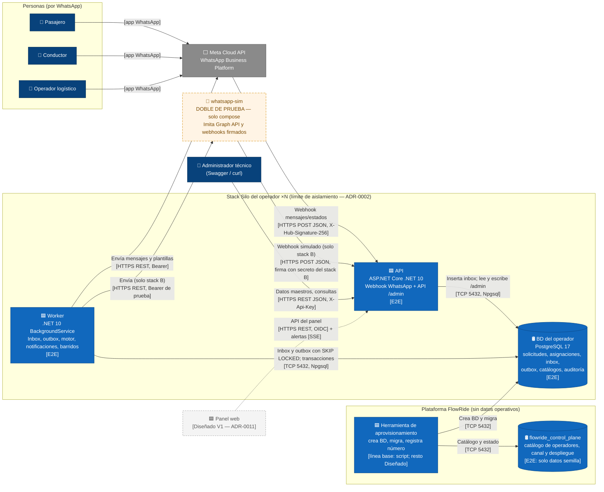

# C4 nivel 2 — Contenedores

**Propósito**: mostrar los contenedores ejecutables y los almacenes de datos de FlowRide y cómo se comunican.
**Alcance**: el stack de **un** operador, que se repite N veces (ADR-0002), más los elementos de plataforma. La instancia concreta con dos operadores (A y B) está en `despliegue.md`.
**Estado**: todos *Diseñados*. Los que tienen la etiqueta `[E2E]` se construyen para la línea base del 4-nov.

**Leyenda**: azul = contenedor de FlowRide; cilindro = almacén de datos; gris = sistema externo; naranja discontinuo = **doble de prueba** (existe solo en el `docker compose` local, nunca en Azure); gris claro discontinuo = Diseñado V1. Cada flecha indica el protocolo entre corchetes.

**Por qué estas piezas y no otras**

| Decisión visible en el diagrama | ADR |
|---|---|
| API y Worker separados, sin llamadas directas entre ellos: se integran a través de las tablas de inbox y outbox | ADR-0001, ADR-0003, ADR-0006 |
| Una base por operador; el control plane no aparece en ninguna flecha de la ruta de mensajes | ADR-0002 |
| Ni broker, ni caché, ni gateway compartido entre Meta y el stack (override de webhook por número) | ADR-0006, ADR-0012, ADR-0015 |
| El simulador habla el mismo contrato que Meta y solo conoce la URL del stack B | ADR-0005 |
| Las alertas al operador salen por WhatsApp; el panel con SSE es V1 | ADR-0003, ADR-0008, ADR-0011 |
