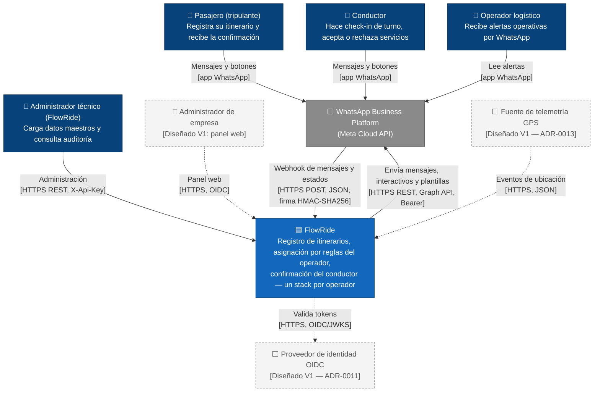

# C4 nivel 1 — Contexto del sistema

**Propósito**: mostrar quién usa FlowRide y de qué sistemas externos depende para F1–F3.
**Alcance**: un operador de transporte (tenant). Cada operador ve exactamente este mismo contexto, aislado de los demás (ADR-0002).
**Estado**: FlowRide está *Diseñado*. Los elementos marcados `[Diseñado V1]` no forman parte de la entrega E2E.

**Leyenda**: azul oscuro = persona; azul = el sistema; gris = sistema externo; borde discontinuo = Diseñado V1 (no forma parte de la entrega E2E). Línea continua = relación E2E; línea punteada = relación Diseñada.

**Notas para la sustentación**
- Pasajero, conductor y operador **no tienen cuenta ni token**: se identifican por su número registrado en la base de su operador (ADR-0005).
- La única dependencia externa de la ruta E2E es Meta, que no ofrece SLA comercial. Su efecto en la disponibilidad compuesta está en ADR-0009.
- Ya no aparecen el proveedor de rutas/ETA ni el correo SMTP de las alertas que tenía el C4 anterior (`docs/_fuentes/Modelo C4 actualizado.drawio.xml`). Los reemplazan la matriz de duración (ADR-0007) y la alerta por WhatsApp (RF-45). Ver el registro de cambios.
