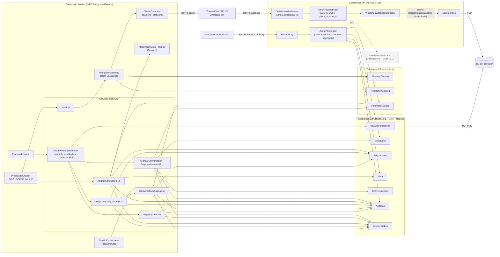

# Diagrama de componentes — dentro del stack de un operador

**Propósito**: mostrar los componentes internos de la API y del Worker, sus puertos y qué building block instancia cada uno en F1–F3.
**Alcance**: un stack (API + Worker + BD). Los nombres coinciden con `paquetes.md`.
**Estado**: Diseñado. `[Diseñado V1]` = no se construye para el 4-nov.

## Building blocks por funcionalidad

| Building block (taxonomía del profesor) | Componente FlowRide | F1 | F2 | F3 | Nota |
|---|---|---|---|---|---|
| Adaptador de entrada (webhook) | `WhatsAppWebhookController` + `FiltroFirmaWebhook` | ✔ | | ✔ | HTTPS + firma (ADR-0005) |
| Notification gateway | `NotificationGateway` + `ClienteGraphApi` | ✔ | ✔ (alerta) | ✔ | Decide sesión o plantilla (ADR-0008) |
| Identidad del canal | Repositorio `UsuarioPorTelefono` | ✔ | | ✔ | No es un proveedor externo (ADR-0005) |
| Message catalog | `MessageCatalog` | ✔ | ✔ | ✔ | |
| Notification catalog | `NotificationCatalog` (plantillas) | | ✔ | ✔ | Camino fuera de la ventana: Diseñado |
| Parameter catalog | `ParameterCatalog` | ✔ | ✔ | ✔ | Rangos en código |
| Repositorio estructurado | `Repositorios.Estructurados` | ✔ | ✔ | ✔ | PostgreSQL por operador |
| Mensajería (productores y consumidores) | Inbox y outbox en PostgreSQL | ✔ | ✔ | ✔ | Sin broker (ADR-0006) |
| Concurrencia | `xmin` + restricción de exclusión | | ✔ | ✔ | |
| Reintento, backoff, *circuit breaker* | `ProcesadorOutbox` + Resilience | | | ✔ | `Fallido` = dead letter |
| Auditoría | `Auditoria` + historial | ✔ | ✔ | ✔ | Solo inserción |
| Logging + correlation ID | `CorrelationMiddleware`, ámbitos de log | ✔ | ✔ | ✔ | Propagado por la outbox |
| HTTPS | Kestrel (compose) / ingress de ACA (Azure) | ✔ | | ✔ | ADR-0003 |

**Building blocks que NO se instancian, con el criterio**

| Building block | Por qué no en F1–F3 |
|---|---|
| Caché | La disponibilidad del conductor es justo lo que se decide; servirla obsoleta rompe `COND-CONF-02`. Con ~40 servicios/día no hay driver de rendimiento (ADR-0012). |
| Message broker | ~400 eventos/día; la outbox en PostgreSQL alcanza y es atómica con el cambio de estado (ADR-0006). |
| Identity provider (OIDC) | Ningún usuario de F1–F3 usa navegador; entra con el panel (ADR-0011). |
| API Gateway / WAF compartido | El override de webhook por número entrega directo a cada stack; un borde común sería un punto de falla común (ADR-0015). |
| Telemetría | V1 (ADR-0013); no participa en la asignación (diferenciador 5). |
| Payment gateway | Sin cobro ni tarifario (exclusión de contexto v10 §6.1). |
| CDN | No hay contenido estático: no hay frontend en la entrega. |
| Generador de QR, acortador de URL, CAPTCHA | Ningún flujo los necesita; el CAPTCHA no aplica a un canal autenticado por la firma de Meta. |
| Service mesh, data mesh | Un solo proceso de aplicación por stack; no hay malla que gestionar. |
| Agentes de IA | Excluidos (contexto v10 §6.1); la conversación es determinista. |
| Storage account | Backups de la BD gestionados por Azure; archivo de auditoría Diseñado (ADR-0016). |
