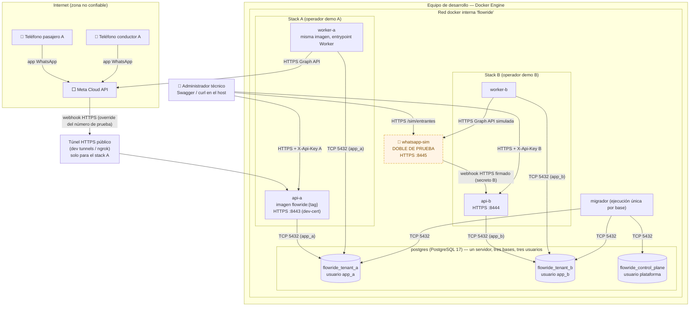
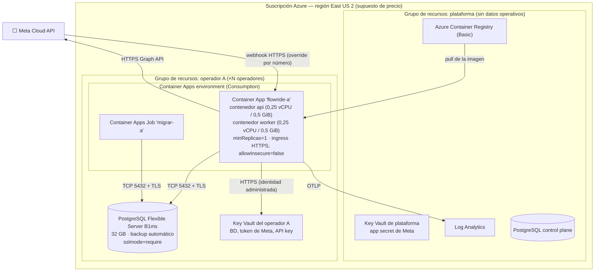

# Diagrama de despliegue

Los lineamientos del curso Ingeniería del Software 2 advierten que el C4 nivel 2 y el despliegue no son equivalentes. Aquí se muestran nodos, redes, zonas de confianza e instancias. Hay dos vistas: la **local** (`docker compose`), que es la que se construye para el 4-nov, y la de **Azure**, que queda Diseñada (ADR-0009).

## D1 — Local: `docker compose` (línea base, se construye para el 4-nov)

**Lo que este despliegue demuestra y lo que no**

| Afirmación | ¿Se demuestra en compose? |
|---|---|
| Cada stack solo tiene la cadena de conexión y el usuario de **su** base (`app_a` no tiene permisos sobre `flowride_tenant_b`) | **Sí**: `PLAT-AIS-01` |
| El simulador solo conoce la URL del stack B; el número de Meta solo apunta al stack A | **Sí** |
| HTTPS en la entrada; HTTP no se publica | **Sí** (puertos HTTPS únicamente) |
| Separación física de **servidores** de BD por operador | **No**: en compose las tres bases comparten un servidor PostgreSQL por economía local. En Azure cada operador tiene su propio Flexible Server (D2). Se declara como diferencia entre entornos, no se oculta |
| Disponibilidad o redundancia | **No**: un host único |

Configuración y secretos: `appsettings.json` con valores no sensibles; secretos (cadena de conexión, API key, token de Meta, app secret, secreto del simulador) en `dotnet user-secrets` o en un `.env` **excluido de Git**; `appsettings.example.json` sin valores reales. Detalle en `delivery/ejecucion-local.md`.

## D2 — Azure (Diseñado, ADR-0009)

El simulador **no existe** en este despliegue. Las opciones contractuales (réplica adicional, HA de zona en la BD) están en ADR-0009 §4.
