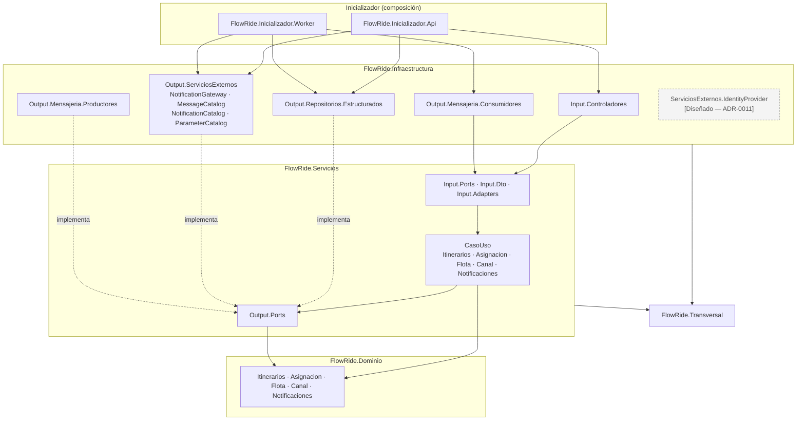

# Diagrama de paquetes — capas × módulos y reglas verificables

**Propósito**: fijar la estructura de proyectos (`.csproj`) y namespaces, y las reglas de dependencia que la prueba arquitectónica hace cumplir (ADR-0001).
**Alcance**: la solución `FlowRide.sln` (un solo artefacto, dos puntos de entrada).
**Estado**: Diseñado. Lo marcado `[Diseñado]` **no se crea** en la línea base: no hay carpetas vacías.

## 1. Eje horizontal — capas (estructura del profesor trasladada a .NET)

| Paquete del profesor (`uco-test-api`) | Proyecto / namespace FlowRide | Contenido en F1–F3 |
|---|---|---|
| `dominio` | `FlowRide.Dominio` | Entidades, objetos de valor, máquinas de estado, motor y reglas |
| `servicios.casouso` | `FlowRide.Servicios.CasoUso` | Casos de uso |
| `servicios.input.ports` | `FlowRide.Servicios.Input.Ports` | Contratos de los casos de uso (`IRegistrarItinerario`…) |
| `servicios.input.dto.request/response` | `FlowRide.Servicios.Input.Dto.Request/Response` | DTO de la API de administración y comandos del canal |
| `servicios.input.adapters` | `FlowRide.Servicios.Input.Adapters` | Ensambladores DTO ↔ comando |
| `servicios.output.ports` | `FlowRide.Servicios.Output.Ports` | Repositorios, `INotificador`, `IMensajeriaWhatsApp`, catálogos, `IReloj`, `IAuditoria`, `IUnidadDeTrabajo` |
| `infraestructura.input.controladores` | `FlowRide.Infraestructura.Input.Controladores` | `WhatsAppWebhookController`, `Admin*Controller`, filtros de firma y API key |
| `infraestructura.output.mensajeria.productores` | `FlowRide.Infraestructura.Output.Mensajeria.Productores` | `EscritorInbox`, `EscritorOutbox` (tablas en PostgreSQL, ADR-0006) |
| `infraestructura.output.mensajeria.consumidores` | `FlowRide.Infraestructura.Output.Mensajeria.Consumidores` | `ProcesadorInbox`, `ProcesadorOutbox`, `BarridoExpiraciones` |
| `infraestructura.output.repositorios.estructurados` | `FlowRide.Infraestructura.Output.Repositorios.Estructurados` | `FlowRideDbContext`, configuraciones de EF, repositorios, migraciones |
| `…repositorios.noestructurados` / `semiestructurados` | — | **No se crean**: no hay almacenes NoSQL ni documentales (ADR-0004) |
| `…serviciosexternos.notificationgateway` | `FlowRide.Infraestructura.Output.ServiciosExternos.NotificationGateway` | `NotificadorWhatsApp` y `WhatsApp.ClienteGraphApi` |
| `…serviciosexternos.messagecatalog` | `…ServiciosExternos.MessageCatalog` | Recursos `es-CO` por clave |
| `…serviciosexternos.notificationcatalog` | `…ServiciosExternos.NotificationCatalog` | Repositorio de `plantilla_whatsapp` |
| `…serviciosexternos.parametercatalog` | `…ServiciosExternos.ParameterCatalog` | Lectura y validación de rangos de `parametro` |
| `…serviciosexternos.identityprovider` | **No se crea** `[Diseñado — ADR-0011]` | En el canal la identidad es un **repositorio** (teléfono → usuario) en `Repositorios.Estructurados`, no un proveedor externo. El proveedor OIDC entra con el panel |
| `…serviciosexternos.telemetry` | **No se crea** `[Diseñado — ADR-0013]` | Telemetría GPS es V1 |
| `…serviciosexternos.paymentgateway` | **No existe** | Excluido del producto (contexto v10 §6.1: sin tarifario ni cobro) |
| `transversal` | `FlowRide.Transversal` | Correlación, ámbitos de logging, `Resultado<T>`, errores con código |
| `inicializador` | `FlowRide.Inicializador.Api`, `FlowRide.Inicializador.Worker` | `Program.cs`, composición de dependencias, configuración y HTTPS |

## 2. Eje vertical — módulos (cortes dentro de cada capa)

| Módulo | Dominio | Servicios.CasoUso | Infraestructura (principal) |
|---|---|---|---|
| **Itinerarios** | `Itinerario`, `SolicitudTransporte`, `EstadoSolicitud`, `CodigoServicio`, `Franja` | `RegistrarItinerario` | Repositorio de solicitudes |
| **Asignacion** | `Asignacion`, `MotorAsignacion`, `Reglas.*` (`ReglaLicenciaVigente`, `ReglaSoatVigente`, `ReglaRtmVigente`, `ReglaBalanceCargaDia`), `PoliticaExpiracion` | `AsignarConductor`, `ResponderAsignacion`, `GestionarFallaAsignacion` | Repositorio de asignaciones |
| **Flota** | `Conductor`, `Vehiculo`, `TurnoConductor`, `Licencia` | `RegistrarCheckin`, carga de datos maestros | Repositorio de flota |
| **Canal** | `Conversacion` (máquina de estados de F1), `TelefonoE164` | `EnrutarMensajeEntrante`, `AvanzarConversacion` | `WhatsAppWebhookController`, `ProcesadorInbox` |
| **Notificaciones** | `TipoNotificacion`, `Notificacion` | `Notificar` | `NotificationGateway`, catálogos |



**Leyenda**: flecha continua = "depende de" (referencia de compilación); punteada = "implementa el puerto"; caja discontinua = Diseñado, no se crea. `FlowRide.Dominio` no tiene flechas salientes.

## 3. Reglas de dependencia que verifica NetArchTest

Proyecto de pruebas: `FlowRide.Pruebas.Arquitectura`. Cada regla es una prueba; si falla, falla el pipeline (ADR-0001).

### 3.1 Capas

| # | Regla | Namespace sujeto | No puede depender de |
|---|---|---|---|
| C1 | El dominio es puro | `FlowRide.Dominio` | `FlowRide.Servicios`, `FlowRide.Infraestructura`, `FlowRide.Transversal`, `FlowRide.Inicializador`, `Microsoft.EntityFrameworkCore`, `Npgsql`, `Microsoft.AspNetCore`, `System.Net.Http` |
| C2 | Los servicios no conocen la infraestructura | `FlowRide.Servicios` | `FlowRide.Infraestructura`, `FlowRide.Inicializador`, `Microsoft.EntityFrameworkCore`, `Npgsql`, `Microsoft.AspNetCore` |
| C3 | Los adaptadores de entrada solo llaman puertos de entrada | `FlowRide.Infraestructura.Input` | `FlowRide.Infraestructura.Output`, `FlowRide.Servicios.CasoUso` (solo `Servicios.Input.Ports`) |
| C4 | Los consumidores no saltan a los casos de uso | `FlowRide.Infraestructura.Output.Mensajeria.Consumidores` | `FlowRide.Servicios.CasoUso` (solo `Servicios.Input.Ports`) |
| C5 | El modelo de Meta no sale de su adaptador | todo excepto `…NotificationGateway.WhatsApp` | `FlowRide.Infraestructura.Output.ServiciosExternos.NotificationGateway.WhatsApp` |
| C6 | EF Core solo en repositorios | todo excepto `…Repositorios.Estructurados` e `Inicializador` | `Microsoft.EntityFrameworkCore` |
| C7 | Nadie depende de los inicializadores | todo `FlowRide.*` excepto `FlowRide.Inicializador` | `FlowRide.Inicializador` |
| C8 | Los repositorios implementan un puerto | clases `*Repositorio` en `…Repositorios.Estructurados` | deben implementar una interfaz de `FlowRide.Servicios.Output.Ports` |

### 3.2 Módulos (cortes verticales)

Matriz de dependencias **permitidas** dentro de `FlowRide.Dominio` (fila depende de columna). Todo lo que no está marcado está prohibido y se prueba:

| ↓ depende de → | Itinerarios | Asignacion | Flota | Canal | Notificaciones |
|---|---|---|---|---|---|
| **Itinerarios** | — | ✘ | ✘ | ✘ | ✘ |
| **Asignacion** | ✔ lee `SolicitudTransporte` y `Franja` | — | ✔ lee `Conductor`, `Vehiculo`, `TurnoConductor` | ✘ | ✘ |
| **Flota** | ✘ | ✘ | — | ✘ | ✘ |
| **Canal** | ✘ | ✘ | ✘ | — | ✘ |
| **Notificaciones** | ✘ | ✘ | ✘ | ✘ | — |

| # | Regla |
|---|---|
| M1 | La matriz anterior se aplica a `FlowRide.Dominio.{Módulo}` (una prueba por cada ✘). |
| M2 | Ninguna clase de `FlowRide.Servicios.CasoUso.{A}` depende de `FlowRide.Servicios.CasoUso.{B}` si A ≠ B. Los casos de uso se encadenan **solo** por eventos de la outbox (ADR-0006). |
| M3 | `FlowRide.Servicios.CasoUso.Canal` no depende de `FlowRide.Dominio.Asignacion`. El canal entrega un comando (`ResponderAsignacion`) por `Servicios.Input.Ports`; no conoce el motor. |
| M4 | Las reglas `Regla*` de `FlowRide.Dominio.Asignacion.Reglas` implementan `IReglaEliminatoria` o `IReglaPuntaje` y no dependen entre sí. |

### 3.3 Forma de la prueba (ejemplo C1 y M1)

```csharp
[Fact]
public void Dominio_no_depende_de_infraestructura_ni_frameworks()
{
    var resultado = Types.InAssembly(typeof(SolicitudTransporte).Assembly)
        .That().ResideInNamespace("FlowRide.Dominio")
        .ShouldNot().HaveDependencyOnAny(
            "FlowRide.Servicios", "FlowRide.Infraestructura", "FlowRide.Transversal",
            "FlowRide.Inicializador", "Microsoft.EntityFrameworkCore", "Npgsql",
            "Microsoft.AspNetCore", "System.Net.Http")
        .GetResult();

    Assert.True(resultado.IsSuccessful, string.Join(", ", resultado.FailingTypeNames ?? []));
}

[Fact]
public void Itinerarios_no_depende_de_Asignacion()
{
    var resultado = Types.InAssembly(typeof(SolicitudTransporte).Assembly)
        .That().ResideInNamespace("FlowRide.Dominio.Itinerarios")
        .ShouldNot().HaveDependencyOn("FlowRide.Dominio.Asignacion")
        .GetResult();

    Assert.True(resultado.IsSuccessful, string.Join(", ", resultado.FailingTypeNames ?? []));
}
```

Limitación declarada: NetArchTest verifica referencias entre tipos, no el comportamiento. Un módulo podría seguir acoplado por SQL (consultar tablas de otro módulo desde su repositorio). Esa regla se revisa en el PR, porque no se puede probar con NetArchTest (lineamientos del curso Ingeniería del Software 2: "el análisis estático no demuestra por sí solo que la arquitectura sea limpia").
