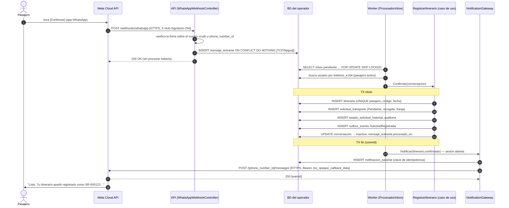
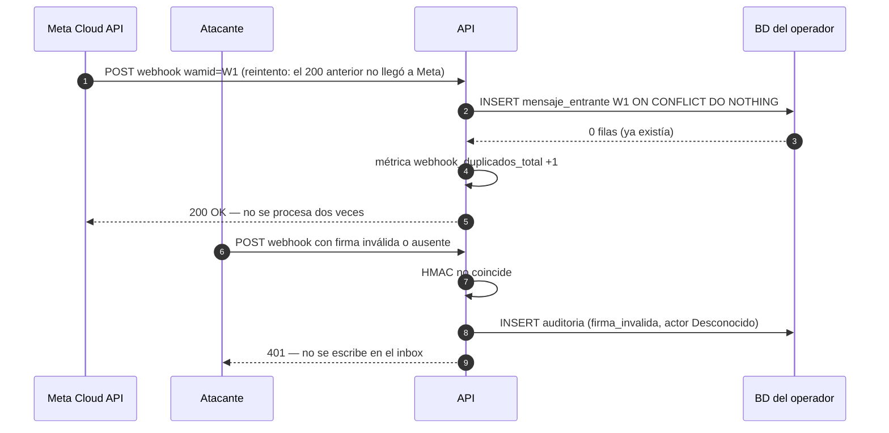
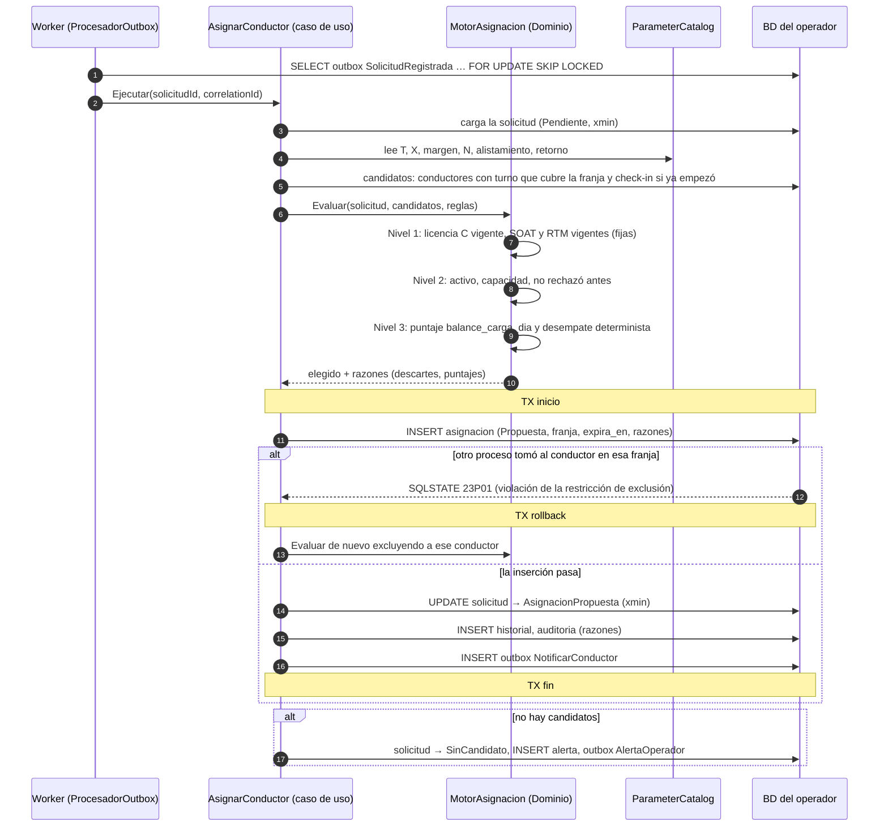
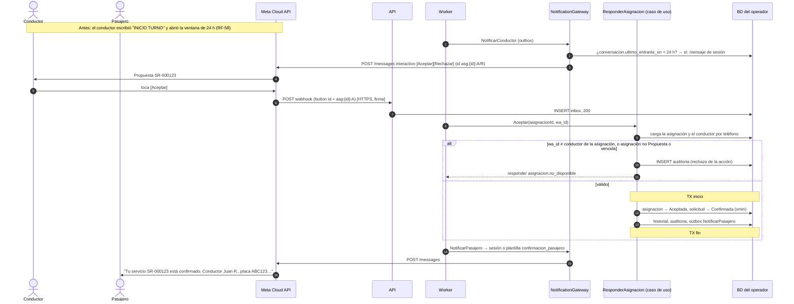
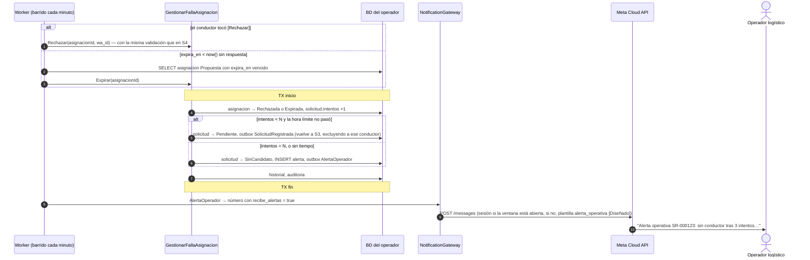
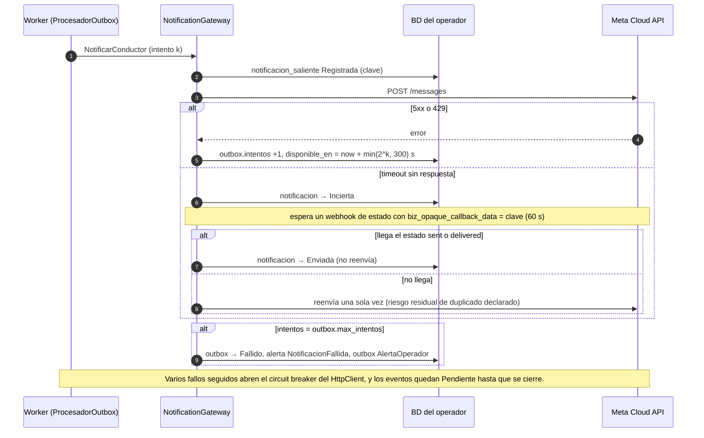

# Diagramas de secuencia — F1, F2 y F3

**Propósito**: mostrar el recorrido exacto de cada funcionalidad, incluidos los caminos de falla que ponen a prueba los escenarios de calidad.
**Alcance**: el stack de un operador. Los participantes son contenedores (C4 nivel 2) y componentes internos (`componentes.md`).
**Estado**: Diseñado. Cada flecha indica su protocolo. Las líneas `TX` marcan el inicio y el fin de una transacción PostgreSQL.

---

## S1 — F1: registro de itinerario (camino normal, último paso)

Los pasos 1–12 de la conversación (`diseno-detallado.md` §1.1) siguen el mismo patrón: webhook → inbox → Worker → `conversacion` → respuesta. Aquí se muestra el paso que crea la solicitud.

## S2 — F1: falla — webhook duplicado y firma inválida (`CANAL-CONF-01`, `CANAL-SEG-01`)

## S3 — F2: asignación automática, incluido el conflicto de concurrencia (`OPLOG-CONF-03`, `OPLOG-CONF-04`)

## S4 — F3: el conductor acepta (`COND-SEG-01`, `COND-ACC-01`)

Un segundo toque de *Aceptar* (mala señal) llega con otro `wamid`. El caso de uso encuentra la asignación ya `Aceptada`, responde `asignacion.no_disponible` y no hay una segunda transición.

## S5 — F3: rechazo o expiración → reencolado → escalamiento al operador (`PAS-CONF-03`)

## S6 — Falla del proveedor al enviar (`PAS-DISP-03` adaptado)

