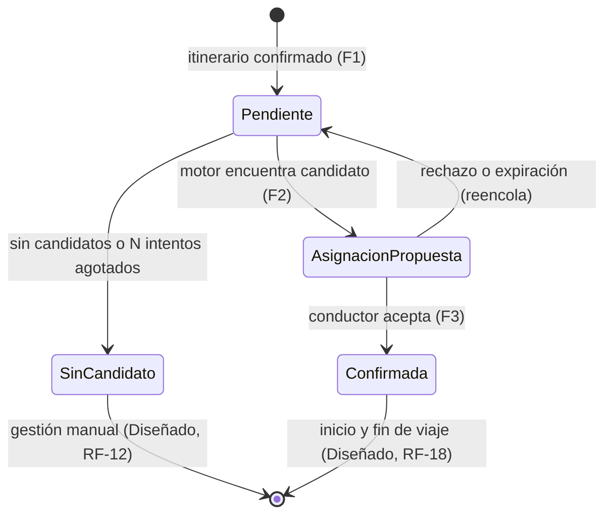
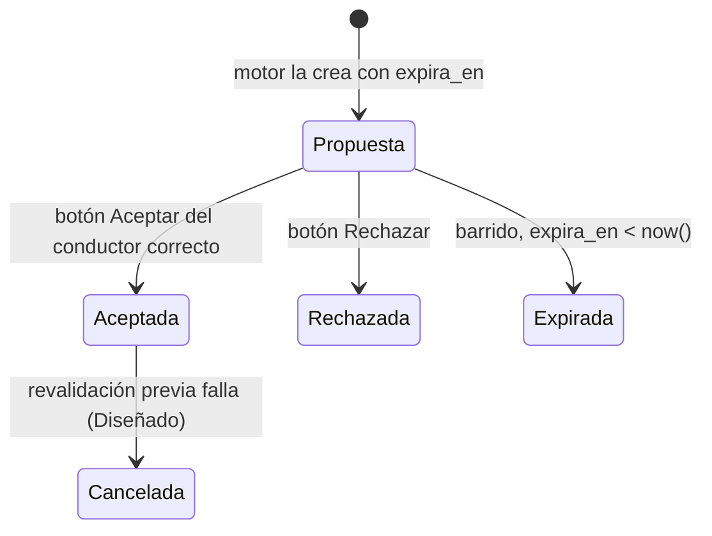

# Diseño detallado de F1–F3

> **Estado: Diseñado.** Nada de esto está implementado ni probado todavía. Es la especificación para construir la línea base del 4-nov.
> Decisiones de origen: ADR-0002 (stack por operador), ADR-0005 (canal), ADR-0006 (consistencia), ADR-0007 (motor), ADR-0008 (catálogos).

## 1. Conversaciones exactas

Convención: **P** = pasajero, **C** = conductor, **O** = operador (número que recibe alertas), **S** = sistema. Los textos salen del catálogo de mensajes (§6); aquí se muestran con valores de ejemplo.

### 1.1 F1 — Registro de itinerario (pasajero registrado y activo)

| # | Quién | Mensaje | Tipo en WhatsApp | Estado de `conversacion` al terminar |
|---|---|---|---|---|
| 1 | P | "Hola" (cualquier texto, fuera de una conversación activa) | texto | — |
| 2 | S | "Hola Ana. Para registrar tu itinerario escribe el código de tu servicio o vuelo (ej. AV9312). Escribe CANCELAR en cualquier momento para salir." | texto | `EsperandoCodigo` |
| 3 | P | "av9312" | texto | — |
| 4 | S | "¿Qué día es el servicio AV9312?" + lista: *Hoy mar 03/11*, *Mañana mié 04/11*… (hasta `itinerario.dias_maximos`) | lista interactiva | `EsperandoFecha` |
| 5 | P | elige *Mañana mié 04/11* | respuesta de lista (`id = fecha:2026-11-04`) | — |
| 6 | S | "¿A qué hora debes presentarte en tu destino? Usa formato 24 h, por ejemplo 04:30." | texto | `EsperandoHora` |
| 7 | P | "04:30" | texto | — |
| 8 | S | "¿Dónde te recogemos?" + lista de lugares frecuentes de su empresa cliente (≤ 10) | lista interactiva | `EsperandoOrigen` |
| 9 | P | elige *Hotel Dann Carlton* | respuesta de lista (`id = lugar:{uuid}`) | — |
| 10 | S | "¿A dónde vas?" + la misma lista sin el origen | lista interactiva | `EsperandoDestino` |
| 11 | P | elige *Aeropuerto JMC* | respuesta de lista | — |
| 12 | S | "Revisa tu itinerario: servicio AV9312, mié 04/11. Presentación 04:30 en Aeropuerto JMC. Recogida estimada 03:25 en Hotel Dann Carlton. ¿Confirmas?" + botones `[Confirmar] [Cancelar]` | botones interactivos | `EsperandoConfirmacion` |
| 13 | P | toca *Confirmar* (`id = conf:si`) | respuesta de botón | — |
| 14 | S | "Listo. Tu itinerario quedó registrado como SR-000123. Te aviso por aquí cuando tenga conductor." | texto | conversación cerrada |

Son **7 mensajes salientes**, con el pasajero solo tocando opciones salvo el código y la hora (`PAS-UX-01`: menos de 3 min).

**Validaciones y respuestas alternativas**

| Condición | Paso | Respuesta (clave del catálogo) |
|---|---|---|
| Remitente no registrado o inactivo en este operador | 1 | `canal.remitente_desconocido`: "Este número no está registrado en el servicio de transporte. Comunícate con tu empresa." No se crea nada; se audita. |
| Código con formato inválido (`^[A-Z0-9-]{2,12}$` tras pasar a mayúsculas) | 3 | `itinerario.codigo_invalido` y se repite la pregunta |
| Hora con formato inválido | 7 | `itinerario.hora_invalida` |
| Presentación con menos de `itinerario.anticipacion_minima_min` de anticipación | 7 | `itinerario.anticipacion_insuficiente`: "Para esa hora ya no alcanzamos a programar. Comunícate con tu operador." Se audita. |
| Ya existe un itinerario con el mismo pasajero, código y fecha | 13 | `itinerario.duplicado` (lo garantiza un `UNIQUE`, ADR-0006) |
| CANCELAR en cualquier paso | — | `conversacion.cancelada`, conversación cerrada |
| Sin respuesta durante `conversacion.expiracion_min` | — | La conversación expira en silencio; el siguiente mensaje empieza de cero |

Cálculo (ADR-0007): `recogida = presentacion − duracion(origen, destino) − recogida.margen_min`. Todo se guarda en UTC; las fechas y horas que escribe o ve el pasajero se interpretan en `operador.zona_horaria`.

### 1.2 Check-in de turno del conductor (RF-58) — abre la ventana de 24 h

| # | Quién | Mensaje |
|---|---|---|
| 1 | C | "INICIO TURNO" (sin distinguir mayúsculas ni tildes) |
| 2 | S | "Turno iniciado: hoy 03:00–11:00. Te enviaré aquí tus servicios." (si no tiene turno vigente: `turno.sin_turno_vigente`) |

### 1.3 F3 — Propuesta al conductor y respuesta

| # | Quién | Mensaje | Tipo |
|---|---|---|---|
| 1 | S → C | "Nuevo servicio SR-000123: mié 04/11, recogida 03:25 en Hotel Dann Carlton, destino Aeropuerto JMC (presentación 04:30). Pasajero: Ana P. Responde antes de las 01:55." + `[Aceptar] [Rechazar]` | botones (sesión) o plantilla `asignacion_servicio` |
| 2a | C | toca *Aceptar* (`id = asg:{asignacionId}:A`) | respuesta de botón |
| 3a | S → C | "Confirmado. SR-000123 queda a tu cargo." | texto |
| 4a | S → P | "Tu servicio SR-000123 está confirmado. Conductor: Juan R., vehículo de placa ABC123. Recogida el mié 04/11 a las 03:25 en Hotel Dann Carlton." | texto (sesión) o plantilla `confirmacion_pasajero` |
| 2b | C | toca *Rechazar* (`id = asg:{asignacionId}:R`) | respuesta de botón |
| 3b | S → C | "Entendido. Asignaremos el servicio a otra persona." | texto |
| — | S → O | (tras N intentos o sin candidatos) "Alerta operativa SR-000123: sin conductor tras 3 intentos. Servicio del 04/11 con recogida a las 03:25. Requiere gestión manual." | texto (sesión) o plantilla `alerta_operativa` |

Si el botón lo toca un número que no es el del conductor de la asignación, o la asignación ya no está `Propuesta`: `asignacion.no_disponible` ("Este servicio ya no está disponible."). No hay transición; se audita (`COND-SEG-01`).

## 2. Plantillas para someter a Meta (categoría UTILITY)

Idioma: `es` (español). El código `es_CO` no se usa porque no se verificó que exista en la lista de idiomas de plantillas; queda en `preguntas-abiertas.md`. Las variables no van al inicio ni al final del cuerpo ni contiguas, para evitar rechazos de formato. Los valores de ejemplo son los que se envían en la solicitud de revisión.

### 2.1 `asignacion_servicio`

- **Categoría:** UTILITY · **Idioma:** es
- **Cuerpo:**
  > Tienes un nuevo servicio asignado, código {{1}}. Recogida el {{2}} a las {{3}} en {{4}}, con destino {{5}}. Por favor confirma antes de las {{6}}.
- **Pie:** `FlowRide`
- **Botones:** respuesta rápida `Aceptar` · respuesta rápida `Rechazar`. El *payload* de cada botón se envía con el mensaje (`asg:{asignacionId}:A` y `asg:{asignacionId}:R`).
- **Ejemplos:** {{1}} SR-000123 · {{2}} 04/11/2026 · {{3}} 03:25 · {{4}} Hotel Dann Carlton · {{5}} Aeropuerto JMC · {{6}} 01:55

### 2.2 `alerta_operativa`

- **Categoría:** UTILITY · **Idioma:** es
- **Cuerpo:**
  > Alerta operativa del servicio {{1}}: {{2}}. Corresponde al {{3}} con recogida a las {{4}}. Requiere gestión manual desde la operación.
- **Pie:** `FlowRide`
- **Botones:** ninguno
- **Ejemplos:** {{1}} SR-000123 · {{2}} sin conductor tras 3 intentos · {{3}} 04/11/2026 · {{4}} 03:25

### 2.3 `confirmacion_pasajero`

- **Categoría:** UTILITY · **Idioma:** es
- **Cuerpo:**
  > Tu servicio {{1}} está confirmado. Conductor: {{2}}, vehículo de placa {{3}}. Recogida el {{4}} a las {{5}} en {{6}}.
- **Pie:** `FlowRide`
- **Botones:** ninguno
- **Ejemplos:** {{1}} SR-000123 · {{2}} Juan R. · {{3}} ABC123 · {{4}} 04/11/2026 · {{5}} 03:25 · {{6}} Hotel Dann Carlton

Estado en el catálogo (`plantilla_whatsapp.estado`): `Borrador → Pendiente → Aprobada | Rechazada`. Si se aprueban antes del 4-nov, la ruta fuera de la ventana pasa de Diseñado a E2E (ADR-0005 §3).

## 3. Máquinas de estado

### 3.1 `SolicitudTransporte`



### 3.2 `Asignacion`



### 3.3 `Conversacion` (F1)

`Inactiva → EsperandoCodigo → EsperandoFecha → EsperandoHora → EsperandoOrigen → EsperandoDestino → EsperandoConfirmacion → Inactiva`. Desde cualquier estado: CANCELAR o expiración → `Inactiva`.

## 4. Modelo de datos

### 4.1 Base de cada operador (`flowride_tenant_{operador}`)

```sql
CREATE EXTENSION IF NOT EXISTS btree_gist;
CREATE EXTENSION IF NOT EXISTS citext;

CREATE TABLE empresa_cliente (
    id          uuid PRIMARY KEY,
    nombre      text NOT NULL,
    nit         text,
    activa      boolean NOT NULL DEFAULT true
);

CREATE TABLE usuario (
    id              uuid PRIMARY KEY,
    nombre          text NOT NULL,
    telefono_e164   text NOT NULL UNIQUE CHECK (telefono_e164 ~ '^\+[1-9][0-9]{7,14}$'),
    rol             text NOT NULL CHECK (rol IN ('Pasajero','Conductor','OperadorLogistico','AdministradorEmpresa')),
    recibe_alertas  boolean NOT NULL DEFAULT false,
    activo          boolean NOT NULL DEFAULT true,
    creado_en       timestamptz NOT NULL DEFAULT now()
);

CREATE TABLE pasajero (
    usuario_id          uuid PRIMARY KEY REFERENCES usuario(id),
    empresa_cliente_id  uuid NOT NULL REFERENCES empresa_cliente(id),
    codigo_interno      text
);

CREATE TABLE vehiculo (
    id          uuid PRIMARY KEY,
    placa       text NOT NULL UNIQUE,
    capacidad   integer NOT NULL CHECK (capacidad > 0),
    soat_vence  date NOT NULL,
    rtm_vence   date NOT NULL,
    activo      boolean NOT NULL DEFAULT true
);

CREATE TABLE conductor (
    usuario_id          uuid PRIMARY KEY REFERENCES usuario(id),
    licencia_numero     text NOT NULL,
    licencia_categoria  text NOT NULL CHECK (licencia_categoria IN ('C1','C2','C3')),
    licencia_vence      date NOT NULL,
    vehiculo_id         uuid REFERENCES vehiculo(id)
);

CREATE TABLE turno_conductor (
    id            uuid PRIMARY KEY,
    conductor_id  uuid NOT NULL REFERENCES conductor(usuario_id),
    periodo       tstzrange NOT NULL,
    checkin_en    timestamptz,
    EXCLUDE USING gist (conductor_id WITH =, periodo WITH &&)
);

CREATE TABLE lugar_frecuente (
    id                  uuid PRIMARY KEY,
    empresa_cliente_id  uuid REFERENCES empresa_cliente(id),   -- NULL = lugar de todo el operador
    nombre              text NOT NULL,
    direccion           text NOT NULL,
    activo              boolean NOT NULL DEFAULT true
);

CREATE TABLE duracion_entre_lugares (
    origen_id   uuid NOT NULL REFERENCES lugar_frecuente(id),
    destino_id  uuid NOT NULL REFERENCES lugar_frecuente(id),
    minutos     integer NOT NULL CHECK (minutos > 0),
    PRIMARY KEY (origen_id, destino_id)
);

CREATE TABLE itinerario (
    id               uuid PRIMARY KEY,
    pasajero_id      uuid NOT NULL REFERENCES pasajero(usuario_id),
    codigo_servicio  text NOT NULL,
    fecha_servicio   date NOT NULL,
    presentacion_en  timestamptz NOT NULL,
    origen_id        uuid NOT NULL REFERENCES lugar_frecuente(id),
    destino_id       uuid NOT NULL REFERENCES lugar_frecuente(id),
    creado_en        timestamptz NOT NULL DEFAULT now(),
    UNIQUE (pasajero_id, codigo_servicio, fecha_servicio),
    CHECK (origen_id <> destino_id)
);

CREATE SEQUENCE solicitud_codigo_seq;

CREATE TABLE solicitud_transporte (
    id                         uuid PRIMARY KEY,
    codigo                     text NOT NULL UNIQUE,          -- 'SR-' || lpad(nextval, 6, '0')
    itinerario_id              uuid NOT NULL UNIQUE REFERENCES itinerario(id),
    pasajero_id                uuid NOT NULL REFERENCES pasajero(usuario_id),
    empresa_cliente_id         uuid NOT NULL REFERENCES empresa_cliente(id),
    presentacion_comprometida  timestamptz NOT NULL,
    recogida_en                timestamptz NOT NULL,
    franja                     tstzrange NOT NULL,
    num_pasajeros              integer NOT NULL DEFAULT 1 CHECK (num_pasajeros > 0),
    es_personal                boolean NOT NULL DEFAULT false,
    urgente                    boolean NOT NULL DEFAULT false,
    estado                     text NOT NULL CHECK (estado IN ('Pendiente','AsignacionPropuesta','Confirmada','SinCandidato','Cancelada')),
    intentos                   integer NOT NULL DEFAULT 0,
    creado_en                  timestamptz NOT NULL DEFAULT now(),
    actualizado_en             timestamptz NOT NULL DEFAULT now()
    -- concurrencia optimista: columna de sistema xmin (ADR-0006)
);

CREATE TABLE estado_solicitud_historial (
    id               bigint GENERATED ALWAYS AS IDENTITY PRIMARY KEY,
    solicitud_id     uuid NOT NULL REFERENCES solicitud_transporte(id),
    estado_anterior  text,
    estado_nuevo     text NOT NULL,
    actor_tipo       text NOT NULL,
    actor_id         uuid,
    ocurrido_en      timestamptz NOT NULL DEFAULT now(),
    correlation_id   uuid NOT NULL
);

CREATE TABLE asignacion (
    id             uuid PRIMARY KEY,
    solicitud_id   uuid NOT NULL REFERENCES solicitud_transporte(id),
    conductor_id   uuid NOT NULL REFERENCES conductor(usuario_id),
    vehiculo_id    uuid NOT NULL REFERENCES vehiculo(id),
    franja         tstzrange NOT NULL,
    estado         text NOT NULL CHECK (estado IN ('Propuesta','Aceptada','Rechazada','Expirada','Cancelada')),
    intento        integer NOT NULL,
    propuesta_en   timestamptz NOT NULL DEFAULT now(),
    expira_en      timestamptz NOT NULL,
    respondida_en  timestamptz,
    razones        jsonb NOT NULL,
    EXCLUDE USING gist (conductor_id WITH =, franja WITH &&) WHERE (estado IN ('Propuesta','Aceptada')),
    EXCLUDE USING gist (vehiculo_id  WITH =, franja WITH &&) WHERE (estado IN ('Propuesta','Aceptada'))
);
CREATE UNIQUE INDEX ux_asignacion_viva_por_solicitud
    ON asignacion (solicitud_id) WHERE estado IN ('Propuesta','Aceptada');
CREATE INDEX ix_asignacion_expira ON asignacion (expira_en) WHERE estado = 'Propuesta';

CREATE TABLE regla_asignacion (            -- solo reglas de puntaje (nivel 3); las eliminatorias están en código
    codigo          citext PRIMARY KEY,     -- 'balance_carga_dia'
    activa          boolean NOT NULL,
    peso            numeric(5,2) NOT NULL CHECK (peso >= 0),
    parametros      jsonb NOT NULL DEFAULT '{}',
    actualizado_en  timestamptz NOT NULL DEFAULT now(),
    actualizado_por text NOT NULL
);

CREATE TABLE parametro (
    clave           citext PRIMARY KEY,
    valor           text NOT NULL,
    actualizado_en  timestamptz NOT NULL DEFAULT now(),
    actualizado_por text NOT NULL
);

CREATE TABLE conversacion (
    telefono_e164       text PRIMARY KEY,
    usuario_id          uuid REFERENCES usuario(id),
    estado              text NOT NULL,
    datos               jsonb NOT NULL DEFAULT '{}',
    ultimo_entrante_en  timestamptz NOT NULL,   -- usado para decidir sesión vs. plantilla (ventana de 24 h)
    expira_en           timestamptz,
    actualizado_en      timestamptz NOT NULL DEFAULT now()
);

CREATE TABLE mensaje_entrante (                -- inbox (ADR-0006)
    provider_message_id  text PRIMARY KEY,      -- wamid de Meta
    telefono_e164        text NOT NULL,
    tipo                 text NOT NULL,          -- text | interactive | button
    contenido            jsonb NOT NULL,         -- solo lo necesario: texto o id del botón/fila
    recibido_en          timestamptz NOT NULL DEFAULT now(),
    correlation_id       uuid NOT NULL,
    procesado_en         timestamptz,
    resultado            text
);
CREATE INDEX ix_inbox_pendiente ON mensaje_entrante (recibido_en) WHERE procesado_en IS NULL;

CREATE TABLE outbox_evento (
    id              bigint GENERATED ALWAYS AS IDENTITY PRIMARY KEY,
    tipo            text NOT NULL,   -- SolicitudRegistrada | NotificarConductor | NotificarPasajero | AlertaOperador
    agregado_id     uuid NOT NULL,
    payload         jsonb NOT NULL,
    correlation_id  uuid NOT NULL,
    estado          text NOT NULL DEFAULT 'Pendiente' CHECK (estado IN ('Pendiente','Procesado','Fallido')),
    intentos        integer NOT NULL DEFAULT 0,
    creado_en       timestamptz NOT NULL DEFAULT now(),
    disponible_en   timestamptz NOT NULL DEFAULT now(),
    procesado_en    timestamptz,
    ultimo_error    text
);
CREATE INDEX ix_outbox_pendiente ON outbox_evento (disponible_en, id) WHERE estado = 'Pendiente';

CREATE TABLE notificacion_saliente (
    id                       uuid PRIMARY KEY,
    clave_idempotencia       text NOT NULL UNIQUE,   -- {tipo}:{agregado_id}:{intento}
    destinatario_usuario_id  uuid NOT NULL REFERENCES usuario(id),
    tipo                     text NOT NULL,
    modo                     text CHECK (modo IN ('Sesion','Plantilla')),
    estado                   text NOT NULL CHECK (estado IN ('Registrada','Enviada','Incierta','Entregada','Leida','Fallida','SinCanal')),
    wamid                    text,
    intentos                 integer NOT NULL DEFAULT 0,
    creado_en                timestamptz NOT NULL DEFAULT now(),
    actualizado_en           timestamptz NOT NULL DEFAULT now()
);

CREATE TABLE plantilla_whatsapp (
    tipo         text PRIMARY KEY,    -- asignacion_servicio | alerta_operativa | confirmacion_pasajero
    nombre_meta  text NOT NULL,
    idioma       text NOT NULL DEFAULT 'es',
    categoria    text NOT NULL DEFAULT 'UTILITY',
    estado       text NOT NULL CHECK (estado IN ('Borrador','Pendiente','Aprobada','Rechazada')),
    variables    integer NOT NULL,
    botones      jsonb NOT NULL DEFAULT '[]'
);

CREATE TABLE alerta (
    id             uuid PRIMARY KEY,
    tipo           text NOT NULL,     -- SinCandidato | IntentosAgotados | ConductorAusente | NotificacionFallida
    solicitud_id   uuid REFERENCES solicitud_transporte(id),
    conductor_id   uuid REFERENCES conductor(usuario_id),
    creado_en      timestamptz NOT NULL DEFAULT now(),
    notificada_en  timestamptz
);

CREATE TABLE auditoria (                        -- solo inserción (ADR-0010)
    id              bigint GENERATED ALWAYS AS IDENTITY PRIMARY KEY,
    ocurrido_en     timestamptz NOT NULL DEFAULT now(),
    actor_tipo      text NOT NULL CHECK (actor_tipo IN ('Pasajero','Conductor','AdministradorTecnico','Sistema','Desconocido')),
    actor_id        uuid,
    accion          text NOT NULL,
    recurso_tipo    text NOT NULL,
    recurso_id      text,
    resultado       text NOT NULL,
    detalle         jsonb NOT NULL DEFAULT '{}',
    correlation_id  uuid NOT NULL
);
-- REVOKE UPDATE, DELETE ON auditoria FROM flowride_app;
```

### 4.2 Base `flowride_control_plane` (fuera del camino crítico, ADR-0002)

```sql
CREATE TABLE operador (
    id         uuid PRIMARY KEY,
    nombre     text NOT NULL,
    nit        text NOT NULL UNIQUE,
    estado     text NOT NULL CHECK (estado IN ('Aprovisionando','Activo','Suspendido')),
    creado_en  timestamptz NOT NULL DEFAULT now()
);

CREATE TABLE operador_despliegue (
    operador_id        uuid PRIMARY KEY REFERENCES operador(id),
    url_stack          text NOT NULL,
    base_datos         text NOT NULL,
    referencia_secretos text NOT NULL,   -- URI de Key Vault o id de user-secrets; nunca el secreto
    version_imagen     text NOT NULL,
    version_migracion  text NOT NULL
);

CREATE TABLE operador_canal (
    operador_id           uuid NOT NULL REFERENCES operador(id),
    phone_number_id       text PRIMARY KEY,
    waba_id               text NOT NULL,
    override_configurado  boolean NOT NULL DEFAULT false
);
```

## 5. Endpoints

| Método y ruta | Proceso | Autenticación | Propósito | Estado |
|---|---|---|---|---|
| `GET /webhooks/whatsapp` | api | `hub.verify_token` | Verificación inicial de Meta (`hub.challenge`) | E2E |
| `POST /webhooks/whatsapp` | api | `X-Hub-Signature-256` | Mensajes y estados. Verifica la firma sobre el cuerpo crudo, valida `phone_number_id`, inserta en el inbox y responde 200 | E2E |
| `POST /admin/empresas-cliente`, `/admin/lugares`, `/admin/usuarios`, `/admin/vehiculos`, `/admin/turnos` | api | `X-Api-Key` | Carga de datos maestros | E2E |
| `PUT /admin/duraciones` | api | `X-Api-Key` | Matriz de duración (lote) | E2E |
| `PUT /admin/parametros/{clave}` | api | `X-Api-Key` | Cambia un parámetro (valida el rango; audita) | E2E |
| `PUT /admin/reglas/{codigo}` | api | `X-Api-Key` | Activa o pondera una regla de puntaje (RF-21) | E2E |
| `GET /admin/solicitudes?estado=&desde=&hasta=&limit=&despues_de=` | api | `X-Api-Key` | Listado paginado por cursor `(creado_en, id)`; `limit` 20 por defecto, máximo 100 | E2E |
| `GET /admin/solicitudes/{id}` | api | `X-Api-Key` | Detalle con historial y asignaciones (con `razones`) | E2E |
| `GET /admin/alertas`, `GET /admin/auditoria?recurso_id=` | api | `X-Api-Key` | Solo consulta | E2E |
| `GET /health/live`, `GET /health/ready` | api | — | Sondas | E2E |
| `POST /{version}/{phone_number_id}/messages` | whatsapp-sim | Bearer de prueba | Imita la Graph API; responde con un `wamid` y emite webhooks de estado | E2E (solo compose) |
| `POST /sim/entrantes` | whatsapp-sim | — (red local) | Inyecta un mensaje "de un teléfono" hacia el stack B, firmado con el secreto del stack B | E2E (solo compose) |
| `GET /sim/bandeja/{telefono}` | whatsapp-sim | — | Muestra lo que el stack B le "envió" a ese teléfono | E2E (solo compose) |
| `PUT /sim/config` | whatsapp-sim | — | Modo de falla de la Graph API simulada (`ninguna`, `5xx`, `timeout`, con duración) y reintento de webhooks al estilo de Meta (si el stack no responde 200, reintenta cada 30 s durante `reintento_max_min`). Lo usan las pruebas de `PAS-DISP-01` y `PAS-DISP-03` | E2E (solo compose) |

Errores de la API de administración: `application/problem+json` con un `codigo` estable del catálogo; nunca trazas internas.

## 6. Catálogo de parámetros (valores por defecto y rangos validados en código)

| Clave | Por defecto | Rango | Usado en |
|---|---|---|---|
| `operador.zona_horaria` | `America/Bogota` | zona IANA válida | F1, F2 |
| `itinerario.anticipacion_minima_min` | 120 | 30–1.440 | F1 |
| `itinerario.dias_maximos` | 7 | 1–9 (cabe en una lista de 10 filas) | F1 |
| `conversacion.expiracion_min` | 30 | 5–120 | F1 |
| `recogida.margen_min` | 15 | 0–120 | F1, F2 |
| `duracion.por_defecto_min` | 45 | 5–240 | F2 |
| `franja.alistamiento_min` | 10 | 0–60 | F2 |
| `franja.retorno_min` | 30 | 0–180 | F2 |
| `turno.tolerancia_checkin_min` | 15 | 0–60 | F2 |
| `asignacion.expiracion_min` (T) | 15 | 5–120 | F2/F3 |
| `asignacion.horizonte_h` (X) | 6 | 1–48 | F2/F3 |
| `asignacion.margen_confirmacion_min` | 90 | 15–360 | F2/F3 |
| `asignacion.max_intentos` (N) | 3 | 1–10 | F2/F3 |
| `outbox.max_intentos` | 8 | 3–20 | todas |
| `outbox.intervalo_ms` | 1.000 | 200–10.000 | todas |
| `notificacion.ventana_confirmacion_s` | 60 | 15–600 | F3 |

Los valores por defecto son una propuesta de partida, no cifras validadas con el operador. Validarlos con el cliente ancla está en `preguntas-abiertas.md`.

## 7. Claves del catálogo de mensajes (es-CO)

`canal.remitente_desconocido` · `conversacion.inicio_itinerario` · `conversacion.cancelada` · `itinerario.pide_fecha` · `itinerario.pide_hora` · `itinerario.pide_origen` · `itinerario.pide_destino` · `itinerario.resumen` · `itinerario.confirmado` · `itinerario.codigo_invalido` · `itinerario.hora_invalida` · `itinerario.anticipacion_insuficiente` · `itinerario.duplicado` · `turno.iniciado` · `turno.sin_turno_vigente` · `asignacion.propuesta` · `asignacion.aceptada_conductor` · `asignacion.rechazada_conductor` · `asignacion.no_disponible` · `asignacion.confirmada_pasajero` · `alerta.sin_candidato` · `alerta.conductor_ausente` · `error.generico`.
